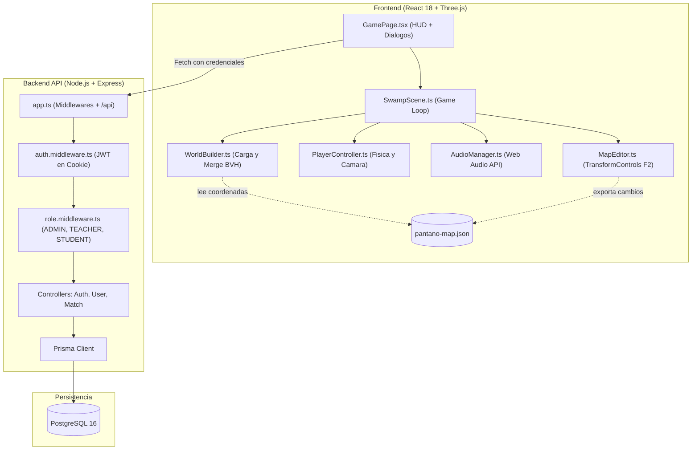
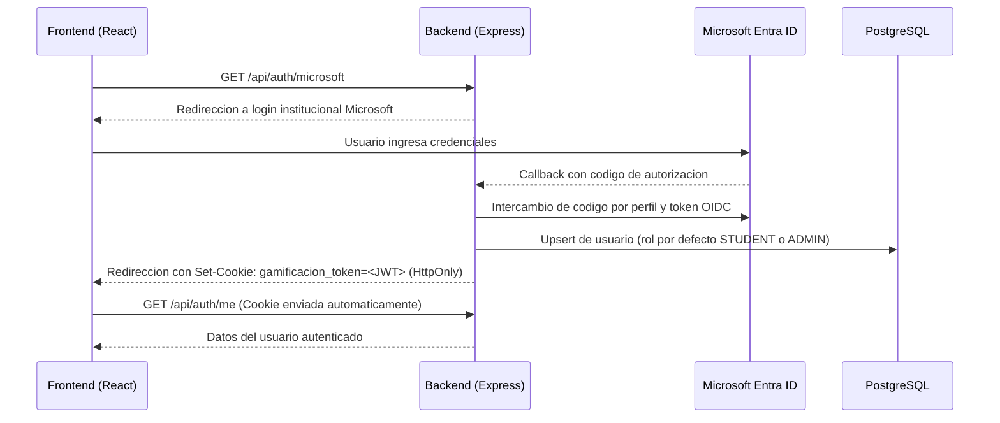

# AGENTS.md — plataforma-gamificacion

Guia operativa para agentes de Inteligencia Artificial y desarrolladores de software que trabajen sobre el repositorio de la **Plataforma de Gamificacion Educativa**.

> **Contexto:** Monorepo compuesto por un backend en Node.js/Express con Prisma y PostgreSQL, y un frontend SPA en React 18 con Three.js (r187), `three-mesh-bvh` y TailwindCSS. Propiedad intelectual de **Janer Fabian Muñoz Bolivar** para uso en la **Universidad de la Amazonia**.

---

## 1. Resumen del Proyecto

- **Proposito:** Plataforma web interactiva para la evaluacion pedagogica y dinamicas de aprendizaje gamificadas en entornos 3D en tiempo real ("Isla del Pantano").
- **Backend:** Node.js 20+ con TypeScript, Express, Prisma ORM, PostgreSQL 16 y autenticacion Microsoft Entra ID + JWT. Puerto por defecto: `4000`.
- **Frontend:** SPA con React 18, TypeScript, Vite 8, Three.js (r187), `three-mesh-bvh` (v0.9.18), Web Audio API y TailwindCSS. Puerto por defecto: `5173` (desarrollo) o `3000` (produccion con Nginx).
- **Sin tests automatizados:** La verificacion se realiza mediante compilacion estricta de TypeScript y pruebas funcionales en navegador o peticiones HTTP.
- **Formato y convenciones:** TypeScript estricto (`tsc --noEmit`), modulos ES, codigo documentado en espanol tecnico, tercera persona o impersonal. **Prohibicion estricta de emojis** en cualquier archivo, comentario, log o respuesta.

| Directorio | Comando | Descripcion |
|------------|---------|-------------|
| `backend/` | `npm run dev` | Inicia backend en modo desarrollo con recarga automatica (`tsx watch`). |
| `backend/` | `npm run build` | Compila TypeScript a JavaScript estandar en `backend/dist/`. |
| `backend/` | `npx prisma generate` | Regenera el cliente tipado de Prisma ORM. |
| `backend/` | `npx prisma db push` | Sincroniza el esquema relacional con la base de datos PostgreSQL. |
| `frontend/` | `npm run dev` | Inicia el servidor de desarrollo Vite en `http://localhost:5173`. |
| `frontend/` | `npm run build` | Compila y optimiza la aplicacion cliente para produccion en `frontend/dist/`. |
| Raiz | `docker compose up -d` | Levanta PostgreSQL, Backend y Frontend en contenedores Docker aislados. |

---

## 2. Arquitectura del Sistema

Flujo general: El cliente React monta el canvas 3D mediante `SwampScene.ts`, delega las colisiones a `three-mesh-bvh` sobre la malla fusionada generada por `WorldBuilder.ts`, e interactua con el backend mediante peticiones REST autenticadas con cookies HttpOnly.



### Mapa de Archivos Criticos

| Archivo | Responsabilidad Primaria |
|---------|--------------------------|
| `frontend/src/game/SwampScene.ts` | Nucleo del bucle de juego 3D (*render loop*), luces, niebla, cielo y coordinacion de subsistemas. |
| `frontend/src/game/WorldBuilder.ts` | Carga de modelos GLB/DAE, lectura de `pantano-map.json`, generacion de malla unificada con `StaticGeometryGenerator` y calculo de arbol BVH. |
| `frontend/src/game/PlayerController.ts` | Control de camara en primera persona, captura de mouse (*Pointer Lock*), gravedad, saltos y deteccion de colisiones mediante proyeccion de capsula contra el arbol BVH. |
| `frontend/src/game/AudioManager.ts` | Sintetizador de audio en tiempo real mediante Web Audio API para pasos (pasto/tierra), chapoteo en agua y saltos. |
| `frontend/src/game/MapEditor.ts` | Editor de escenarios en tiempo real activado con tecla `F2`. Permite transformar objetos y generar el JSON actualizado. |
| `frontend/public/maps/pantano-map.json` | Unica fuente de verdad de la disposicion espacial de objetos 3D, escalas y rotaciones del escenario. |
| `frontend/src/pages/GamePage.tsx` | Contenedor React del juego. Gestiona atajos de teclado (`Alt`, `F2`), HUD superior e inferior, y menus de pausa compatibles con pantalla completa. |
| `frontend/src/components/ui/dialog.tsx` | Componente de dialogo adaptado con la propiedad `container` para renderizarse dentro del elemento en pantalla completa. |
| `backend/src/server.ts` | Punto de entrada del servidor backend, gestion del ciclo de vida y conexion con base de datos. |
| `backend/src/app.ts` | Configuracion de Express, CORS, Helmet, CookieParser y enrutamiento modular bajo `/api`. |
| `backend/src/config/index.ts` | Fuente unica centralizada para la lectura de variables de entorno. |
| `backend/src/middlewares/auth.middleware.ts` | Extraccion y verificacion del JWT desde cookie HttpOnly o cabecera `Authorization`. |
| `backend/src/middlewares/role.middleware.ts` | Verificacion estricta de roles de usuario (`ADMIN`, `TEACHER`, `STUDENT`). |
| `backend/src/controllers/auth.controller.ts` | Flujo de autenticacion con Microsoft Entra ID y emision de tokens de sesion. |
| `backend/src/controllers/match.controller.ts` | Logica de creacion de salas, inscripcion de participantes, administracion de equipos y cambio de estados de partidas. |

---

## 3. Reglas de Negocio y Tecnicas INVIOLABLES

> Estas directrices garantizan la estabilidad, rendimiento y mantenibilidad del sistema. **No deben alterarse bajo ninguna circunstancia sin autorizacion expresa.**

### 3.1 Desacoplamiento de Coordenadas en `pantano-map.json`

- **Regla:** Queda estrictamente prohibido definir o hardcodear posiciones, rotaciones o escalas de objetos del escenario dentro del codigo TypeScript de `SwampScene.ts` o `WorldBuilder.ts`.
- **Implementacion:** Todos los objetos instanciados deben leerse desde [pantano-map.json](file:///C:/Users/Janer/Documents/Desarrollo/Gamificaión/plataforma-gamificacion/frontend/public/maps/pantano-map.json). Cualquier modificacion a la escena debe realizarse mediante el Editor de Mapas (`F2`) o editando directamente dicho archivo JSON.

### 3.2 Colisiones Exactas con `three-mesh-bvh`

- **Regla:** El motor de colisiones utiliza exclusivamente `three-mesh-bvh` sobre geometrias estaticas fusionadas mediante `StaticGeometryGenerator`.
- **Prohibicion:** Esta terminantemente prohibido regresar a sistemas basados en cajas envolventes `Box3` o esferas aproximadas para elementos arquitectonicos o de terreno, ya que impiden subir escalones, atravesar vanos de puertas o transitar por plataformas elevadas.
- **Compatibilidad de Malla:** Al agregar o modificar modelos 3D, asegurarse de que las geometrias posean atributos de posicion e indices validos para evitar excepciones en `StaticGeometryGenerator.generate()`.

### 3.3 Soporte de Dialogos en Pantalla Completa (*Fullscreen*)

- **Regla:** En modo de pantalla completa (`document.fullscreenElement !== null`), el navegador oculta cualquier capa o modal montado en `document.body`.
- **Implementacion:** Todos los dialogos modales (menus de pausa, confirmaciones, alertas) deben montarse pasando la propiedad `container` vinculada a la referencia del contenedor de juego (`gameRootRef.current` o `document.fullscreenElement`).
- **Liberacion de Puntero:** Al abrir cualquier menu o ventana emergente, es mandatorio invocar `playerController.unlockPointer()` para que el cursor del raton sea visible y permita la interaccion con los botones.

### 3.4 Manejo de Atajos de Teclado y Tecla `Alt`

- **Regla:** En entornos web de pantalla completa, la tecla `Escape` es capturada nativamente por el navegador para abandonar la pantalla completa. Por tanto, `Escape` **no** debe ser el unico mecanismo de pausa.
- **Implementacion:** La tecla designada para alternar el menu de pausa es `Alt` (acompanada del boton grafico en el HUD). Los detectores de eventos deben registrarse en la fase de captura (`window.addEventListener('keydown', handler, { capture: true })`) y llamar a `event.preventDefault()` cuando se presione `Alt` para no desviar el foco a la barra de herramientas del sistema operativo.

### 3.5 Audio Procedural Liviano

- **Regla:** Los efectos de sonido ambientales y de desplazamiento se sintetizan en tiempo real mediante `AudioManager.ts` haciendo uso de la Web Audio API.
- **Prohibicion:** No cargar archivos de audio masivos (MP3, WAV o FLAC) que incrementen los tiempos de descarga de la aplicacion en redes de ancho de banda restringido.

### 3.6 Prohibicion Absoluta de Emojis

- **Regla:** En cumplimiento de las directrices de calidad y sobriedad tecnica, esta totalmente prohibido el uso de caracteres emoji en comentarios de codigo, mensajes de consola (`console.log`, `console.error`), respuestas JSON de la API, cadenas de interfaz de usuario o documentacion tecnica. Utilizar unicamente texto formal en espanol y simbologia estandar.

---

## 4. Bucle de Juego y Fisica 3D

```mermaid
sequenceDiagram
    participant RAF as RequestAnimationFrame
    participant Loop as SwampScene.animate()
    participant Ctrl as PlayerController.update(delta)
    participant BVH as three-mesh-bvh (Collider)
    participant Aud as AudioManager

    RAF->>Loop: Tick (delta time)
    Loop->>Ctrl: update(delta)
    Ctrl->>Ctrl: Procesar entradas (WASD, Shift, Espacio)
    Ctrl->>Ctrl: Aplicar gravedad y velocidad vertical
    Ctrl->>BVH: shapecast(playerCapsule)
    BVH-->>Ctrl: Contactos y normales de colision
    Ctrl->>Ctrl: Corregir posicion y detectar si esta en suelo (onGround)
    alt Cambio de posicion sobre terreno
        Ctrl->>Aud: playFootstep(isWater ? 'water' : 'grass', isRunning)
    end
    Loop->>Loop: Actualizar shaders de agua y posicion de nubes
    Loop->>Loop: Renderizar frame en Canvas WebGL
```

---

## 5. Autenticacion y Control de Acceso



- **Almacenamiento de Token:** Cookie segura HttpOnly (`gamificacion_token`). Opcionalmente se acepta cabecera `Authorization: Bearer <token>` para clientes externos.
- **Verificacion de Rol:** Cada endpoint protegido invoca el middleware `authorizeRoles('ADMIN', 'TEACHER')`.

---

## 6. Procedimiento para Verificar Cambios

Dado que no existen tests unitarios automatizados, todo agente o desarrollador debe realizar las siguientes comprobaciones antes de dar por finalizada una tarea:

1. **Compilacion estricta del Backend:**
   ```bash
   cd backend
   npm run build
   ```
   Debe compilar sin advertencias ni errores de tipos TypeScript (`code 0`).

2. **Compilacion estricta del Frontend:**
   ```bash
   cd frontend
   npm run build
   ```
   Debe generar el directorio `dist/` sin errores de importacion, empaquetado o tipos.

3. **Verificacion Funcional en Navegador:**
   - Cargar `http://localhost:5173`.
   - Entrar al escenario 3D y confirmar que el personaje no cae al vacio al reaparecer.
   - Presionar `Clic` para capturar raton; desplazarse con `WASD`, correr con `Shift` y saltar con `Espacio`.
   - Probar el acceso a la choza ceremonial saltando sobre los troncos de parkour colocados al frente.
   - Probar pantalla completa (tecla `F11` o boton de pantalla completa).
   - Presionar `Alt`: verificar que el menu de pausa se muestre visible encima del canvas y que el cursor del raton se libere para permitir interactuar con los botones.
   - Presionar `F2`: confirmar que el editor de mapas active los gizmos de seleccion sin lanzar excepciones en consola.

---

## 7. Checklist para Agentes de IA

Antes de reportar una tarea como completada, verifique:

- [ ] ¿Se ejecuto `npm run build` en `backend/` y `frontend/` con salida limpia (codigo 0)?
- [ ] ¿Se respetaron los archivos de configuracion sin hardcodear credenciales ni URLs?
- [ ] ¿Las posiciones y escalas de objetos 3D estan en `pantano-map.json` y no en codigo TypeScript?
- [ ] ¿Los dialogos modales utilizan el contenedor de pantalla completa para evitar quedar ocultos?
- [ ] ¿Al pausar o abrir modales se llama a `unlockPointer()` en el controlador del jugador?
- [ ] ¿Se evito por completo el uso de emojis en logs, mensajes, comentarios y documentacion?
- [ ] ¿Se empleo unicamente espanol tecnico y redaccion en tercera persona o impersonal?

---

## 8. Anti-Patrones y Errores Comunes

| Anti-Patron Detectado | Accion Correcta |
|-----------------------|-----------------|
| Colocar posiciones fijas `mesh.position.set(...)` en `SwampScene.ts` | Agregar o actualizar las coordenadas dentro de `frontend/public/maps/pantano-map.json`. |
| Usar `new THREE.Box3()` para colisionar con casas o terreno | Integrar la geometria en `WorldBuilder.ts` con `StaticGeometryGenerator` y generar el arbol BVH. |
| Montar modales de Radix UI directamente en `document.body` | Pasar `container={gameRootRef.current}` para asegurar compatibilidad en pantalla completa. |
| Usar unicamente la tecla `Escape` para pausar el juego | Usar la tecla `Alt` y botones en pantalla con captura de evento (`capture: true`). |
| Dejar el cursor bloqueado (`PointerLock`) cuando se despliega un menu | Invocar `playerController.unlockPointer()` al detectar apertura de modales o pausa. |
| Incluir emojis en mensajes de log o en la interfaz | Redactar mensajes en texto formal en espanol, sin emojis ni caracteres decorativos. |
| Cargar librerias pesadas de audio o archivos `.mp3` de alto peso | Utilizar los sintetizadores matematicos nativos de `AudioManager.ts` (Web Audio API). |
